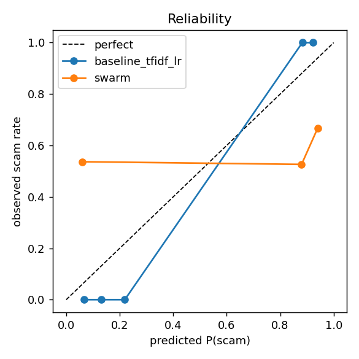

# Signal Swarm eval (2026-11-08 02:22)
Test rows: 265 | backend: http://127.0.0.1:8000

| system | accuracy | precision | recall | F1 | legit FPR | ECE | p50 ms | p95 ms |
|---|---|---|---|---|---|---|---|---|
| baseline_tfidf_lr | 1.0 | 1.0 | 1.0 | 1.0 | 0.0 | 0.091 | 0.04 | 0.04 |
| swarm | 0.479 | 0.553 | 0.182 | 0.274 | 0.172 | 0.452 | 7.7 | 19.7 |

## baseline_tfidf_lr: per category
| category | n | P | R | F1 / FPR |
|---|---|---|---|---|
| account_suspension | 12 | 1.0 | 1.0 | 1.0 |
| appointment | 26 | - | - | 0.0 |
| bank_alert | 18 | - | - | 0.0 |
| bank_fraud | 9 | 1.0 | 1.0 | 1.0 |
| delivery_notice | 16 | - | - | 0.0 |
| friend | 28 | - | - | 0.0 |
| giftcard_grandkid | 11 | 1.0 | 1.0 | 1.0 |
| irs_gov | 11 | 1.0 | 1.0 | 1.0 |
| job_offer | 14 | 1.0 | 1.0 | 1.0 |
| otp_harvest | 16 | 1.0 | 1.0 | 1.0 |
| package_delivery | 19 | 1.0 | 1.0 | 1.0 |
| pharmacy | 16 | - | - | 0.0 |
| prize | 11 | 1.0 | 1.0 | 1.0 |
| romance | 15 | 1.0 | 1.0 | 1.0 |
| toll_ezpass | 16 | 1.0 | 1.0 | 1.0 |
| twofa | 18 | - | - | 0.0 |
| wrong_number_crypto | 9 | 1.0 | 1.0 | 1.0 |

Worst errors (ids): none

## swarm: per category
| category | n | P | R | F1 / FPR |
|---|---|---|---|---|
| account_suspension | 12 | 0.16 | 0.333 | 0.216 |
| appointment | 26 | - | - | 0.0 |
| bank_alert | 18 | - | - | 0.167 |
| bank_fraud | 9 | 0.045 | 0.111 | 0.065 |
| delivery_notice | 16 | - | - | 0.0 |
| friend | 28 | - | - | 0.0 |
| giftcard_grandkid | 11 | 0.192 | 0.455 | 0.27 |
| irs_gov | 11 | 0.0 | 0.0 | 0.0 |
| job_offer | 14 | 0.0 | 0.0 | 0.0 |
| otp_harvest | 16 | 0.432 | 1.0 | 0.604 |
| package_delivery | 19 | 0.0 | 0.0 | 0.0 |
| pharmacy | 16 | - | - | 0.0 |
| prize | 11 | 0.0 | 0.0 | 0.0 |
| romance | 15 | 0.0 | 0.0 | 0.0 |
| toll_ezpass | 16 | 0.0 | 0.0 | 0.0 |
| twofa | 18 | - | - | 1.0 |
| wrong_number_crypto | 9 | 0.0 | 0.0 | 0.0 |

Worst errors (ids): s92c1a33ee0, s92698593f6, s9cd9742a0a, sf97e9e1ad0, s4a2eb8c334, sa5369d2fb8, s8d7a900fa3, s1b63eb795b, s3845a31ba6, s8fa54a2147

Per-category precision is one-vs-legit (a category's scams against all legit rows). Positive = verdict scam or suspicious; P(scam) = riskScore/100.
Data is synthetic (stand-in for the T-Mobile set).

